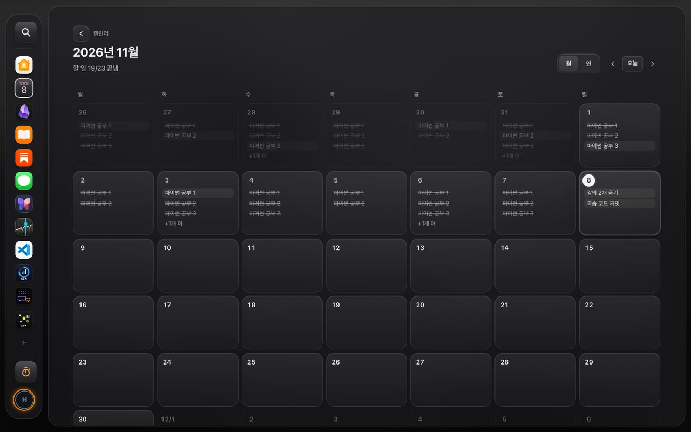
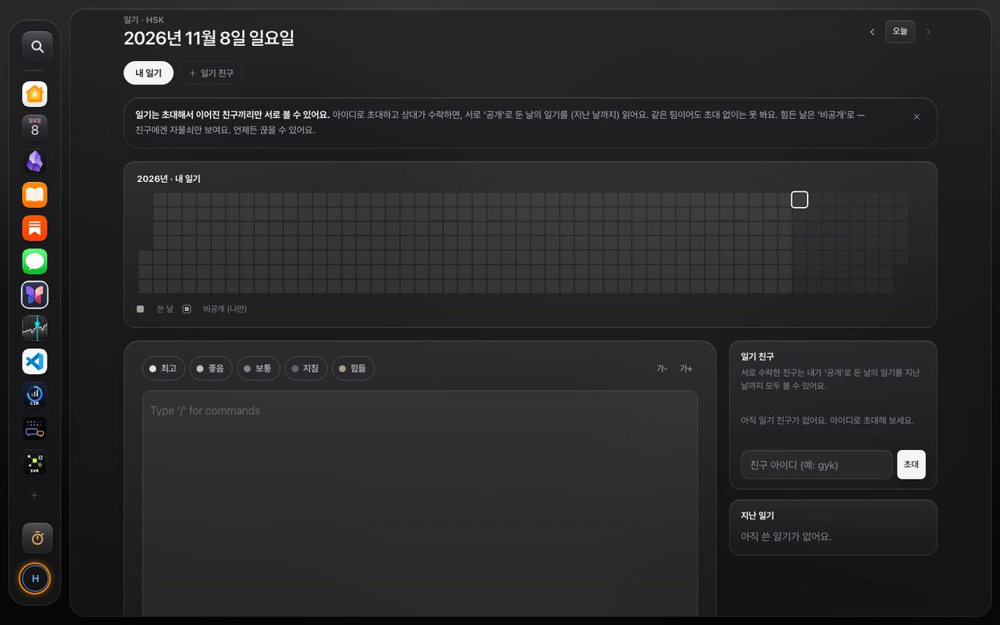
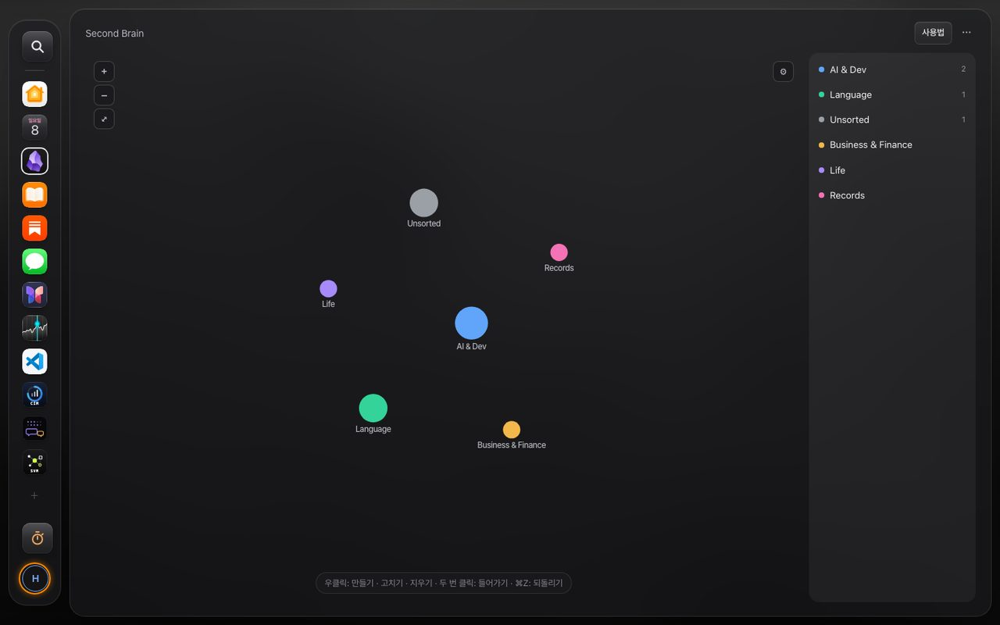
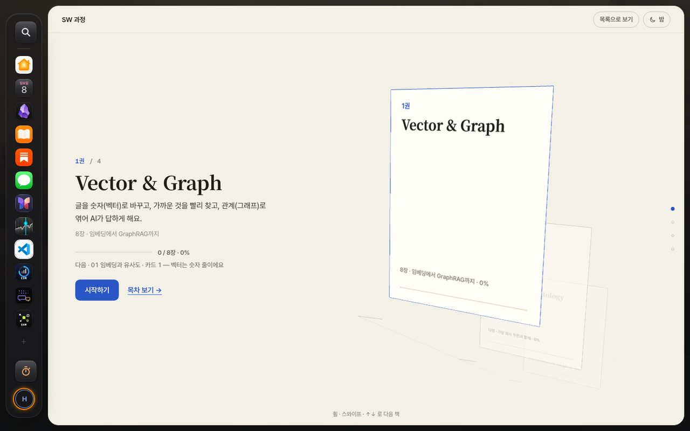
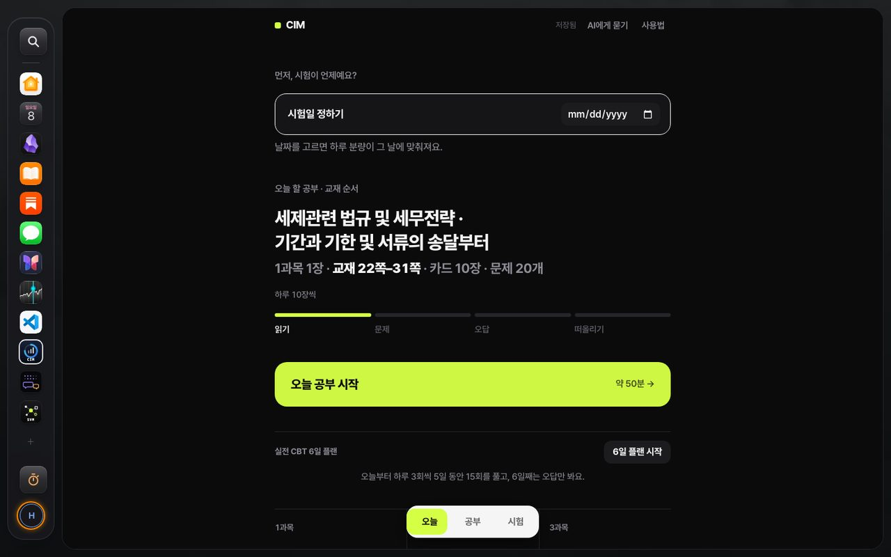
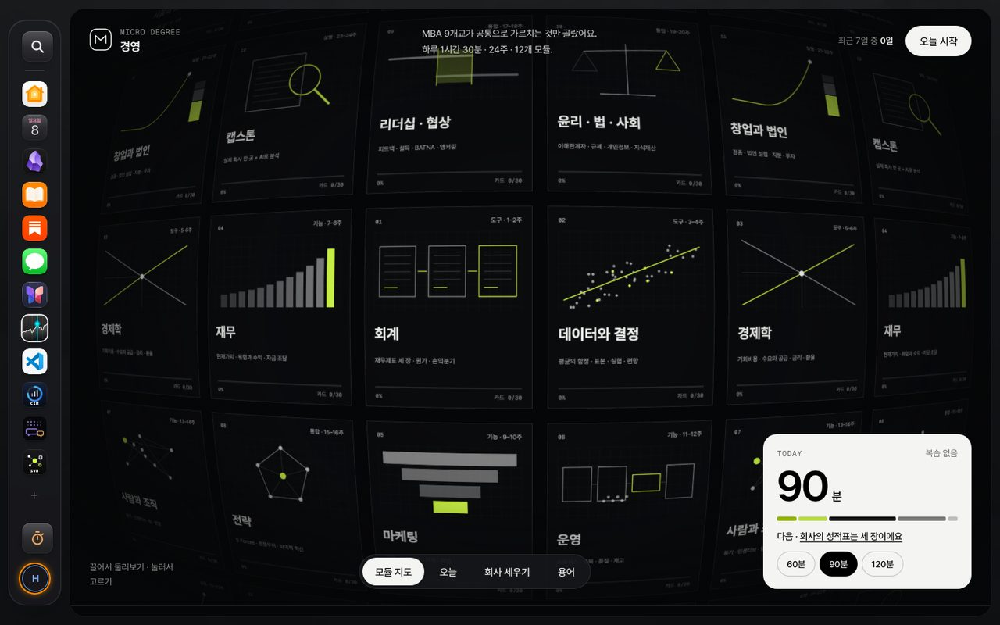
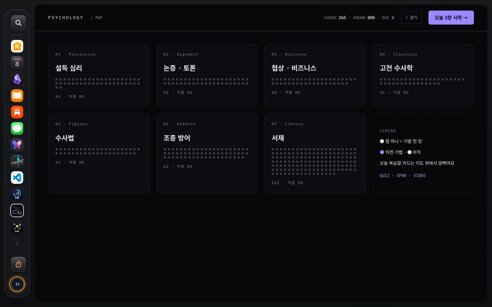
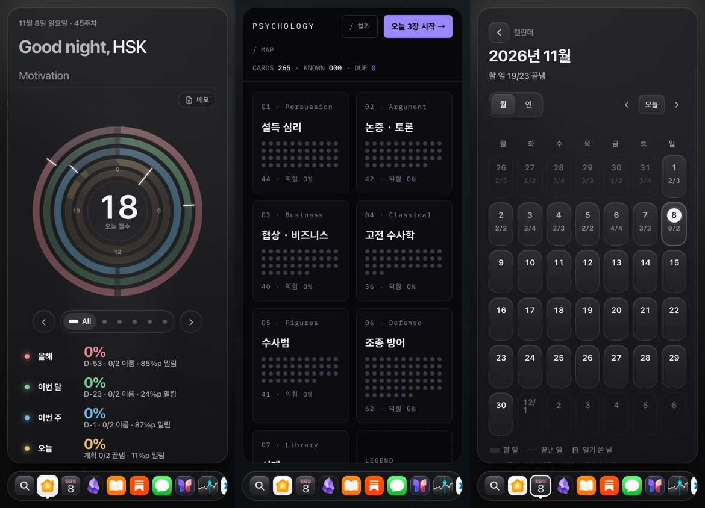

<div align="center">


# SWx2

[](https://swx2.swx2.workers.dev)


<p>

</p>

## What in

### Planning and Record

| 앱 | 주소 | 한 줄 |
|---|---|---|
| 홈 | `#/` | 올해 · 이번 달 · 이번 주 · 오늘 링 차트, AI 챗봇 |
| 캘린더 · 계획 | `#/calendar` | 5분 단위 하루 계획표, 끌어서 옮기기 · 길이 조절 |
| 체크리스트 · 목표 | `#/checklist` · `#/goals/…` | 우선순위(Low → Max) 할 일, 주 · 월 · 년 목표 |
| 일기 | `#/diary` | 하루 한 편 + 기분, 초대한 친구와만 |

<p align="center">
  
  
</p>

### Note and Talking

| 앱 | 주소 | 한 줄 |
|---|---|---|
| 노트 · Brain | `#/notes` · `#/brain` | Notion식 블록 편집기, 옵시디언식 그래프 |
| 대화방 · 창고 | `#/room` | 실시간 채팅(@AI), 책 · 링크 · 영상 모음 |
| 뉴스 | `#/news` | 하루 한 부 신문 |

<p align="center">
  
</p>

### Study

| 앱 | 주소 | 한 줄 |
|---|---|---|
| SW 교과서 | `#/sw` | 종이 교과서 느낌의 책 · 목차 · 카드, 번호 붙은 그림, AI 튜터 |
| CIM | `#/cim` | 자격증 공부, 출처 달린 RAG 튜터 |
| MBA | `#/mba` | 24주 마이크로 디그리 — 카드 · 케이스 · 문제 · 강의 |
| 심리 | `#/psy` | 설득 심리 · 수사학 카드, 지도 · 복습(SRS) · 퀴즈 · AI 토론 |
| 영어 · 논문 · 책 | `#/english` · `#/papers` · `#/books` | 단어 · 논문 번역 · 책 공부 |
| Silicon Valley Mafia | `#/svm` | 관리자 전용 · Curtis Yarvin 글 15편 (요약 · 원문 + 번역) · 영상 · 지식그래프 |

<p align="center">
  
  
</p>
<p align="center">
  
  
</p>
<p align="center">
  
  
</p>

**어디서나:** `⌘K` 검색 · 집중 타이머 · ⌘Z 되돌리기 · 다크/라이트 · 모든 AI 입력창에서 웹 검색 · 사진 넣기 · 푸시 알림 · macOS 위젯(`macos/TrioWidget`).
기능 자세히 → [docs/guide/features.md](docs/guide/features.md)

### 📱 폰에서도

설치형 웹앱(PWA)이라 폰 홈 화면에 앱처럼 깔려요. 아래 Dock 으로 앱 사이를 오가요.

<p align="center">
  
</p>

## I make it

```
브라우저 (PWA · Service Worker 캐시)
   │  빌드 없는 ES 모듈 — public/js/app.js 셸 + js/views/* 화면
   ▼
Cloudflare Worker  ── src/worker.js (ai · brain · calendar · room · mcp · rag …)
   ├─ D1        계획 · 노트 · 일기 · 계정
   ├─ R2        사진 · 파일
   ├─ Vectorize 뜻으로 찾기(RAG)
   └─ Cron      하루 점수 · 뉴스
```

- **빌드 단계가 없어요.** 파일을 고치면 그대로 배포돼요.
- **MCP 서버 내장** — 다른 AI 도구에서 계획 · 노트를 읽고 쓸 수 있어요 → [mcp.md](docs/guide/mcp.md)
- **보안** — 세션 · CSRF · 초대 기반 공유 → [security.md](docs/guide/security.md)

## 🚀 빠른 시작

```bash
npm install
npm run db:init        # 로컬 D1 테이블
npm run dev            # http://localhost:8787 (로컬은 아이디만 입력하면 로그인)
npm run test:quick     # 바뀐 곳만 빠르게 검사
```

AI 키는 `.dev.vars`에 넣어요 (git에 안 올라가요) → [docs/guide/ai.md](docs/guide/ai.md)

## 🛠 자주 쓰는 명령

| 하고 싶은 것 | 명령 |
|---|---|
| 검사 (빠름 / 보통 / 전부) | `npm run test:quick` · `test:normal` · `test:full` |
| 실제 브라우저 검사 (데스크톱 + 폰) | `npm run e2e` |
| 계정 만들기 | `npm run user:add -- <아이디> <이름> <비밀번호> [--remote]` |
| 배포 | `npm run deploy:all` |
| 로컬 DB 초기화 | `npm run db:reset` |

## 📖 문서

| 문서 | 내용 |
|---|---|
| [features.md](docs/guide/features.md) | 화면별 기능 전체 |
| [dev.md](docs/guide/dev.md) | 디자인 고치기 · 로컬 실행 · 테스트 · 계정 · 배포 |
| [ai.md](docs/guide/ai.md) | AI 키 받는 곳 · 모델 순서 · RAG(뜻으로 찾기) |
| [social-api.md](docs/guide/social-api.md) | 캘린더 · 같이 하기 · 대화방 · 창고 API |
| [mcp.md](docs/guide/mcp.md) | MCP 서버 연결 · 도구 · 작업판 |
| [news.md](docs/guide/news.md) | 뉴스 백엔드 · 크론 |
| [security.md](docs/guide/security.md) | 인증 · 세션 · CSRF · 프라이버시 |
| [papers-english.md](docs/guide/papers-english.md) | 지난 논문 스프린트 · 영어 연동 |
| [DESIGN.md](DESIGN.md) | 디자인 규칙 |

## 🗂 구조

```
src/          Worker API (worker.js 진입, ai · brain · calendar · room · mcp · rag …)
migrations/   D1 스키마
public/       정적 프론트엔드 (js/app.js 셸 · js/views/* 화면 · css/tokens.css)
scripts/      테스트 · 시드 · 계정 · 배포 스크립트
macos/        macOS 위젯 (TrioWidget)
docs/         가이드 · 설계 문서
legacy/       예전 단일 파일 버전
```

<div align="center">
<sub>Made with ☕ by HSK · GYK — and a lot of Claude.</sub>
</div>
